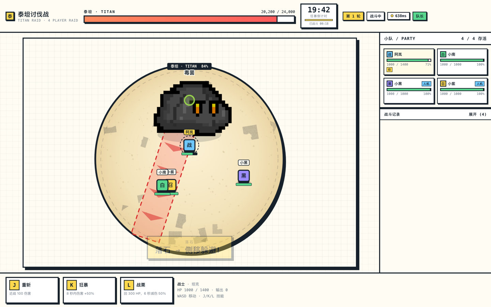
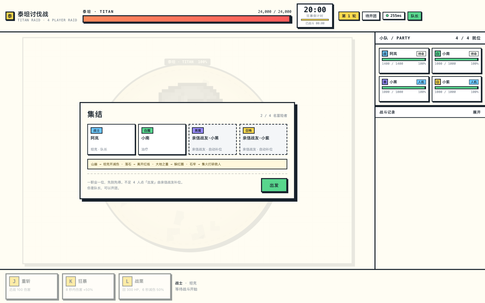
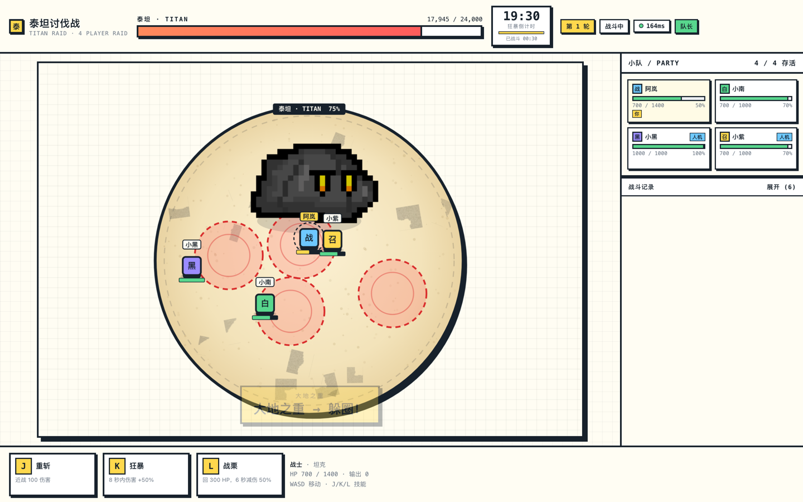
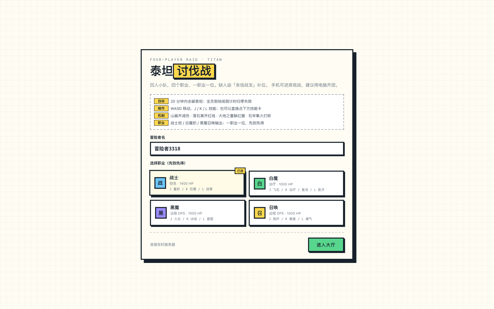

# 泰坦讨伐战 · Titan Raid

一个在浏览器里四个人一起打的 2D 团本。玩法照着 FF14 的土神改的：四个职业、四套机制、二十分钟狂暴。
联机没有自己写服务端，全走 CloudBase Realtime。



## 这是什么

俯视角、一块圆形场地、一个会追着坦克跑的泰坦。四个位置各司其职：坦克扛伤、治疗奶人、两个输出打本体兼救人。
人不够的时候缺的位置由「亲信战友」的人机补上，一个人也能开，四个人一起才是完整难度。

进去之后大概长这样：



## 四个机制

机制每 12 秒来一次，按 山崩 → 落石 → 大地之重 → 石牢 的顺序轮，每轮结束后整体伤害 +10%。

| 机制 | 场上长什么样 | 该干什么 |
| --- | --- | --- |
| 山崩 | Boss 朝坦克方向读条，一条粗线 | 战士开减伤硬吃，其他人别站在坦克身后 |
| 落石 | 一条红色直线预警 | 侧移出线，吃到就是一大截血 |
| 大地之重 | 场上散开几个红圈，读完还有一次全屏跺脚 | 先躲圈，再回中间集合吃群疗 |
| 石牢 | 随机点名一个人关进石头里，5 秒不打碎就没了 | 所有人转火石头，治疗留着复活 |

泰坦的 HP 是 24000，狂暴 20 分钟，打完之后有一张 DPS 结算。



## 职业

一个职业只能一个人选，先到先得。

| 职业 | 定位 | J | K | L |
| --- | --- | --- | --- | --- |
| 战士 | 坦克 1400 HP | 重斩 | 狂暴（8 秒伤害 +50%） | 战栗（回血 + 6 秒减伤） |
| 白魔 | 治疗 1000 HP | 飞石 | 治疗 / 复活 | 医济（全队回血） |
| 黑魔 | 远程输出 1000 HP | 火炎 | 冰结 | 雷暴 |
| 召唤 | 远程输出 1000 HP | 毁坏 | 毒菌 | 瘴气 |

## 联机是怎么做的

### 房主权威

第一个进房的人当房主，游戏逻辑（Boss 走位、机制时钟、伤害结算、人机）只在他那边跑，60fps。
其他人只上报输入，收到快照后照着画，自己操控的角色做一点本地预测，不然按键会觉得黏。

快照以 20Hz 广播出去，客户端按实际到达的间隔插值，网络抖一下也不会跳帧。

### 三条实时链路

| 链路 | 用来干嘛 |
| --- | --- |
| Broadcast（`raid:main`） | 输入、快照、特效、开始 / 重开 |
| Presence | 大厅里谁在、选了什么职业、房主还在不在 |
| postgres_changes | 机制播报和战斗日志：事件写进表，再靠 CDC 推回来 |

关键事件（机制开始、伤害结算、倒地、胜负）是写进 `raid_events` 表的，频道上订阅这张表的 INSERT：

```ts
const channel = realtime.channel('raid:main', {
  config: {
    broadcast: { self: true, ack: true },
    presence: { enabled: true, key: clientId },
  },
});

channel.on('broadcast', { event: '*' }, (msg) => apply(msg));
channel.on('presence', { event: 'sync' }, () => setRoster(channel.presenceState()));
channel.on('postgres_changes', { event: 'INSERT', schema: 'public', table: 'raid_events' }, (payload) => {
  pushLog(payload.new);
});
```

这么拆的原因挺实际：走广播的东西丢了就丢了，下一帧快照能补回来；而「谁被点名了」「谁倒了」这种一句话的事必须留下记录，顺便新进来的人也能翻到这一局的日志。

另外房主每 2 秒把 `boss_hp / phase / round` upsert 到 `raid_state`，进房的人先读一次，不至于进来看到满血 Boss。

### 后台节流这个坑

房主把页面切到后台，Chrome 会把主线程的定时器节流到 1 秒一次，其他人看到的移动就开始一顿一顿。
所以房主模拟跑在 Web Worker 里，切后台之后快照改走 Realtime 的 REST 广播（约 8Hz），绕开被节流的主线程。最顺的玩法还是让房主的窗口留在前台，或者干脆用另一台机器当房主。

## 跑起来

需要 Node 18+ 和一个开通了 Postgres 的 CloudBase 环境。

```bash
npm install
cp .env.example .env.local   # 填你自己的环境信息
npm run dev                  # http://localhost:5173
```

`.env.local` 三个值：

```
VITE_CLOUDBASE_ENV_ID=你的环境ID
VITE_CLOUDBASE_REGION=ap-shanghai
VITE_CLOUDBASE_ACCESS_KEY=你的 Publishable Key
```

Publishable Key 是给浏览器用的那把，可以公开；别把服务端 API Key 填进去。

然后准备环境：

1. 在 CloudBase 的 SQL 编辑器里跑一遍 [`sql/schema.sql`](sql/schema.sql)，建 `raid_events` 和 `raid_state`，顺便把两张表加进实时发布；
2. 实时设置里允许公开频道，并打开 Presence（大厅和频道都靠它）；
3. 把环境 ID、Region、Publishable Key 填进 `.env.local`。

自己开一局：开四个浏览器窗口（或者几台设备）各自进房、选不同职业，第一个进去的那个点「出发」。



同一个浏览器多开几个标签页也算不同客户端，够用了。

部署就是普通的静态站点，`npm run build` 之后把 `dist/` 传到你自己的静态托管上就行，前端不需要额外的服务端。

## 操作

- `WASD` 移动，`J / K / L` 技能，也可以直接点下面的技能卡
- 手机能进房观战，还没做触屏移动
- 链接后面加 `?debug=1` 会多显示频道名、延迟、CDC 事件数和展开的战斗记录，联机出问题的时候方便看
- `?speed=3` 把房主那边的模拟加速 3 倍，自己试机制的时候省时间

## 目录

```
src/
├── realtime/client.ts      # 连接、频道、读写库
├── realtime/events.ts      # 广播事件名和日志文案
├── game/engine.ts          # 房主端逻辑：机制时钟、伤害、人机
├── game/hostWorker.ts      # 把房主模拟扔进 Worker
├── game/render.ts          # Canvas 绘制
├── hooks/useRoom.ts        # 房间聚合：presence / 快照 / CDC / 房主选举
├── components/             # 大厅、战斗面板、技能栏、结算……
└── styles/app.css
sql/schema.sql              # 建表 + 授权 + 加进实时发布
scripts/                    # 用 CDP 跑端到端的小脚本
```

## 还没做的

- 全服就一个房间 `raid:main`，没有多房间，也没有账号系统，进来就是匿名
- 数值是拍脑袋定的，打到后面几轮基本就是拼减伤和奶量
- 手机只能观战，触屏操作没做
- 观战视角和玩家视角是一样的，没有专门做导播

## 素材和声明

灵感来自 FF14 的泰坦讨伐战，非官方，纯属个人玩票，没有拿它做任何商业用途。

- 泰坦 sprite：`monsters_of_nature` / Rock（CC0，OpenGameArt）
- 地砖：`tileset_cave_01.png`（CC0，OpenGameArt）
- 玩家和其余 UI 都是 Canvas 现画的

代码随便看随便改，MIT。
